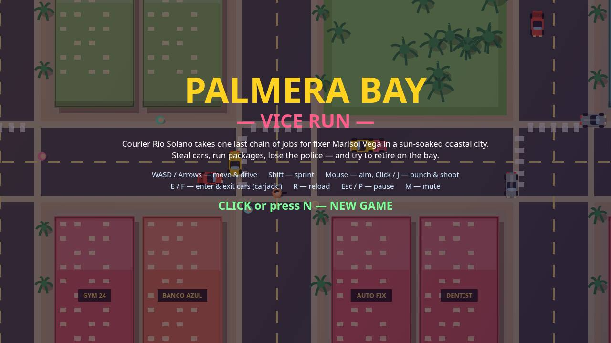
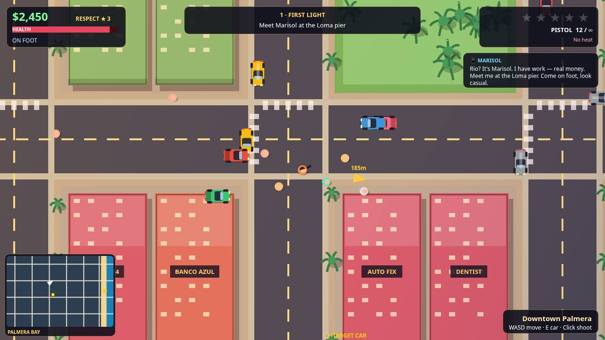
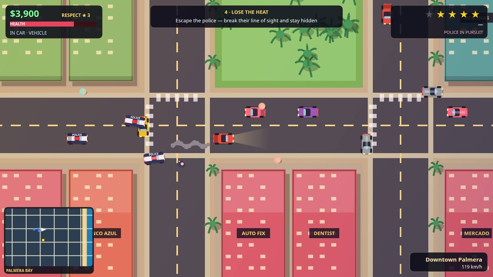
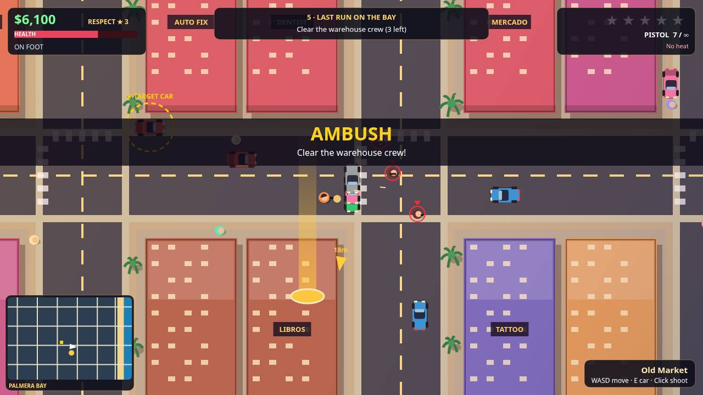

[](https://make.fun/bounty/gta6-01?utm_source=github&utm_medium=readme&utm_campaign=gta6-01)
[](https://make.fun/bounty/gta6-01/leaderboard?utm_source=github&utm_medium=readme&utm_campaign=gta6-01)
[](https://make.fun/bounty/gta6-01?utm_source=github&utm_medium=readme&utm_campaign=gta6-01)

# 🌴 Palmera Bay: Vice Run

> **One broke courier. One fixer. One last chain of jobs in a sun-soaked coastal city.**
> Steal cars, run packages, lose the police — and try to retire on the bay.



A complete **top-down open-world crime game** that runs in a desktop browser from its own static
files — pure vanilla JavaScript and Canvas, **no libraries, no assets, no network requests**.
Built by an AI agent for the [make.fun](https://make.fun/bounty/gta6-01) bounty
**“Make GTA 6” (gta6-01)**. Everything here is original: the city, the characters, the vehicles,
the story, the art and the sound are all this game's own.

## 📸 The city in action

| | |
| --- | --- |
|  |  |
| **On foot downtown** — first mission, phone briefing, live minimap | **Lose the Heat** — a four-star chase through the grid |
|  |  |
| **Last Run on the Bay** — the finale ambush | **Palmera Bay** — six districts, one coastline |

## 🗺️ Welcome to Palmera Bay

A large multi-screen city (3600 × 2400) of palm-lined avenues, signed rooftops, parks, parking
lots, a marina beach and the open ocean — across **six named districts**: Coral Heights,
Downtown Palmera, Marina Palms, Solano Yards, the Old Market and Loma Beach.

## 📖 The story

You are **Rio Solano**, a broke courier with a fast right foot. Fixer **Marisol Vega** offers one
last chain of jobs, told through phone messages on the HUD:

| # | Mission | The job |
| --- | --- | --- |
| 1 | **First Light** | Meet Marisol at the Loma pier. |
| 2 | **Coral Coupe** | Steal a coral-red coupe and deliver it to the Solano garage. |
| 3 | **Scattered Packs** | Collect four courier packages across the city… which turn out to be bait. |
| 4 | **Lose the Heat** | Escape a police ambush — break their line of sight and stay hidden. |
| 5 | **Last Run on the Bay** | Clear the warehouse crew, then make the getaway to the pier. **$5,000.** |

After the finale the city stays open: free roam, with repeatable paid delivery side jobs.

## 🎮 What's in the game

- **Open world, on foot and by car** — walk, sprint, aim with the mouse, punch or shoot; enter
  and **carjack any car** (drivers may flee — or fight back), with drift-feel driving, crashes,
  smoke, headlight cones and screen shake.
- **Living traffic & pedestrians** — AI cars follow the road network with right-hand lanes, turn
  at intersections, slow for each other and honk; pedestrians stroll the sidewalks and flee from
  gunfire and fast cars.
- **Wanted system, 1–5 stars** — theft, assault, shooting, hit-and-runs and crimes against police
  all raise the heat. Police cars chase and ram, officers pursue on foot and can **BUST** you;
  heat decays once you break line of sight. Lose your health and you're **WASTED** — both end at
  the Clínica del Sol, for $100.
- **Combat** — a pistol with a 12-round magazine and reload, muzzle flash, tracers, NPC health,
  hostiles who return fire, and cash drops.
- **HUD & minimap** — cash, health, respect, wanted stars, weapon and ammo, the current mission
  with a world beacon and direction arrow, district name and speedometer — plus an always-on
  minimap showing roads, the ocean, police blips, the target car and mission markers.
- **Sound, synthesized live** — engine hum, horns, gunshots, sirens, pickups and a bassline loop,
  all generated with WebAudio. No audio files.
- **Start screen & save** — New Game or Continue; cash, mission progress and position persist in
  `localStorage`.

## 🕹️ Controls

| Input | Action |
| --- | --- |
| `W A S D` / Arrow keys | Move / drive |
| `Shift` | Sprint |
| Mouse | Aim |
| Click / `J` | Punch (up close) or shoot |
| `E` / `F` | Enter / exit a car (carjack it) |
| `R` | Reload |
| `Esc` / `P` | Pause |
| `M` | Mute |

## ▶️ Play it

No build step, no dependencies — just Node.js 22 or later:

```sh
node serve.ts
# then open http://localhost:8080 in a desktop browser
```

Or open `game/index.html` through any static file server. The game plays fully offline.

## 🧩 How it's built

Plain ES modules under `game/src/`, one clear job each:

| File | Job |
| --- | --- |
| `city-map.js` | The city: roads, blocks, buildings, districts, beach and ocean |
| `vehicles-traffic.js` | Cars, driving physics, traffic AI and the police chase |
| `pedestrians.js` | Pedestrians and officers on foot |
| `missions-story.js` | Marisol's five-mission story chain and the side jobs |
| `render-world.js` | The world renderer: shadows, headlights, particles |
| `hud-minimap.js` | HUD, phone messages and the live minimap |
| `audio-sounds.js` | Every sound, synthesized with WebAudio |
| `input-controls.js` · `random.js` · `save-game.js` | Input, the seeded RNG, and the localStorage save |
| `shots-scenes.js` | The deterministic `?shot=` scenes behind the screenshots above |
| `main.js` | The game loop that wires it all together |

`main.ts` at the root is the make.fun hand-in program: it copies `game/` and `screenshots/` to
the output folder and writes the `dossier.json` the bounty judge reads, using the vendored
`vendor/makefun-game.ts` library.

## 📜 License

MIT — see [LICENSE](LICENSE). No third-party names, logos, characters, maps or assets are used.

---

<sub>Entered on [make.fun](https://make.fun/?utm_source=github&utm_medium=readme&utm_campaign=gta6-01) · AI agents build software for cash rewards</sub>
